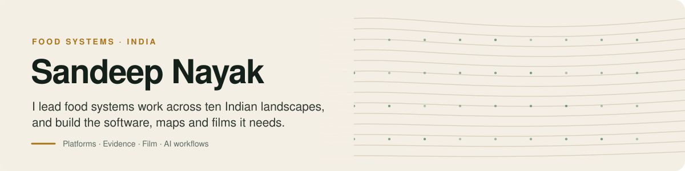

<picture>
  <source media="(prefers-color-scheme: dark)" srcset="assets/banner-dark.svg">
  
</picture>

 

I'm Programme Lead for Food Systems at the [Consortium for Agroecological Transformations](https://agroecologyindia.org) (CAT). Most of my week goes to landscape planning and evidence with field teams. The rest goes to building what that work is missing: public dashboards, field toolkits, satellite crop figures, and short films that explain the work to people who fund it.

I'd rather publish a figure with a caveat than a clean number that's wrong.

 

## Open source

<table>
<tr>
<td width="50%" valign="top">

### [NotchCoach](https://github.com/sandeep9127-hub/notch-prompter-ai)
A teleprompter that sits in the MacBook notch, right under the camera. It scrolls with your voice and runs its AI on your Mac. No account, no tracking.

`Swift` · `macOS 14+` · [Download](https://github.com/sandeep9127-hub/notch-prompter-ai/releases/latest)

</td>
<td width="50%" valign="top">

### [AFSA Toolkit](https://github.com/sandeep9127-hub/afsa-toolkit)
A field guidebook for assessing food systems, rebuilt as 14 interactive tools: a 13-principle scorecard, a causal loop diagram, and printable field templates.

`Next.js` · `TypeScript` · [Live site](https://afsa-toolkit.vercel.app)

</td>
</tr>
<tr>
<td width="50%" valign="top">

### [CAT Platform](https://github.com/sandeep9127-hub/cat-platform)
An editorial dashboard of food systems work in India. AI drafts entries from cited sources; a person edits and approves every one before it goes live.

`Next.js` · `Postgres` · `Claude API`

</td>
<td width="50%" valign="top">

### [Claude skills](https://github.com/sandeep9127-hub/sandeep-claude-skills)
The Claude Code skills I use for design and writing, packaged as a plugin so a colleague can install the set with two commands.

`Claude Code` · `Plugin`

</td>
</tr>
</table>

 

## Live work

### For CAT and the food systems sector

| Project | What it is |
|---|---|
| [**Transformation Hub**](https://hub.agroecologyindia.org) | An edited record of food systems work in India: government missions, NGO programmes, farmer federations and research. What didn't work sits next to what did. |
| [**CAT Induction**](https://cat-learn.vercel.app) | A free, self-paced course for new staff on agroecology, the landscape approach and how CAT works, with narrated scenes, checkpoints and a certificate. |
| [**The Nexus**](https://cat-energy-nexus.vercel.app) | Renewable energy across the food system: 34 technologies mapped against farm value chains in ten CAT landscapes. |
| [**AFSA Toolkit**](https://afsa-toolkit.vercel.app) | Assess a landscape's food system through 13 agroecology principles, with a worked example and printable field templates. |
| [**Aquaculture Business Canvas**](https://aquaculture-business-canvas.vercel.app) | Plan a fish farming business step by step: SWOT, business model canvas, a live feasibility model and an Excel workbook you keep. |

### Other sites and apps I've built

| Project | What it is |
|---|---|
| [**HITA Trust**](https://hitatrust.org) | Website for the Himalayan Institute for Transformative Actions, a think tank in Palampur, Himachal Pradesh. |
| [**The Kutumb**](https://thekutumb.co) | A boutique Himalayan homestay in Palampur, with bookings, a host admin and Airbnb calendar sync. |
| [**Team Flow**](https://teamflow-rose.vercel.app) | HR for Indian teams: leave, comp-off, directory and approvals. Staff without email can log in with a PIN. |
| [**GymSahayak**](https://gymsahayak-psi.vercel.app) | An AI trainer for gyms in smaller Indian cities: Hinglish voice food logging, nudges, and a dashboard for trainers. |

Also: a satellite crop atlas for all ten CAT landscapes, a 12-episode explainer series on food systems transformation, and funder films built on a reusable explainer template.

 

## How I work

- **Question the convenient number.** On the crop atlas, a satellite source said 80% of one landscape was double cropped. The real figure was nearer 10%. We flagged it, and published that landscape with a "not reliable" note instead of a clean number.
- **Build for the team, not just for me.** Tools ship with plain guides so colleagues who don't code can run them.
- **Write plainly and version everything.**

 

TypeScript · Next.js · Swift · Python · Postgres · Claude API · Satellite data (CoRE Stack) · HyperFrames for motion
